# EventHub — Tài liệu Thiết kế Giao diện (UI/UX Mockups & Flow Specification)

Tài liệu này tổng hợp toàn bộ **Kiến trúc luồng người dùng (User Flows)**, **Quy chuẩn thiết kế (Design System)** và **Bộ sưu tập màn hình thực tế (Mockups / Screen Showcase)** của nền tảng **EventHub** cho cả 3 phân hệ: **Khách hàng (Customer)**, **Nhà cung cấp dịch vụ (Provider)** và **Quản trị viên (Admin)**.

---

## 1. Hệ thống Quy chuẩn Thiết kế (Design System)

Nền tảng EventHub tuân theo ngôn ngữ thiết kế **Material Design 3 (M3)** kết hợp phong cách hiện đại (Modern Glassmorphism & Soft Shadows):

### 1.1. Bảng màu chủ đạo (Color Palette)
- **Primary / Brand Color**: Deep Purple (`#673AB7`) kết hợp Indigo (`#6366F1`) tạo cảm giác chuyên nghiệp, sáng tạo cho các sự kiện.
- **Accent / Highlight Color**: Amber Gold (`#F59E0B` / `#FBBF24`) dùng cho các huy hiệu (Badge), nút đánh giá sao và đồng hồ đếm ngược.
- **Surface & Dark Mode**: Dark Navy (`#0B0E24` / `#0F172A`) với độ tương phản cao, bảo vệ mắt và sang trọng.
- **Bộ 6 màu nền cá nhân hóa (Custom Themes)**: Trắng, Xám, Xanh dương, Xanh lá, Đỏ, Vàng (người dùng tự do tùy biến trong Cài đặt).

### 1.2. Kiểu dáng & Tương tác (Components & Styling)
- **Bo góc (Corner Radius)**: Bo cong mềm mại 12px – 20px (thẻ dịch vụ 16px, nút bấm bo tròn viên thuốc 28px).
- **Hệ thống đổ bóng (Elevation & Shadows)**: Shadow đa tầng mềm (`blurRadius: 16`, `offset: (0, 8)`), hạn chế viền đen cứng.
- **Đa ngôn ngữ (i18n)**: Hỗ trợ chuyển đổi tức thì giữa **Tiếng Việt** và **English**.

---

## 2. Sơ đồ Luồng Người Dùng (User Flow Diagrams)

### 2.1. Luồng Khách hàng (Customer Journey)
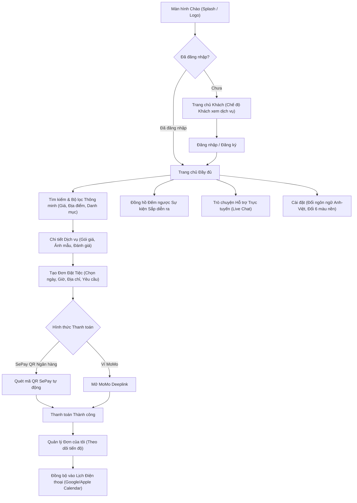

### 2.2. Luồng Nhà cung cấp (Provider Journey)
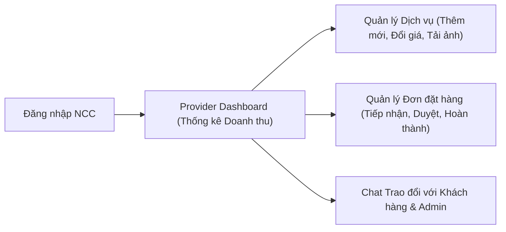

### 2.3. Luồng Quản trị viên (Admin Flow)
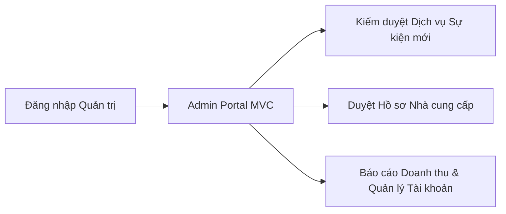

---

## 3. Bộ sưu tập Màn hình Mockup Thực tế (Screenshots Showcase)

Tất cả các hình ảnh dưới đây được trích xuất trực tiếp từ ứng dụng thực tế đang chạy trên thiết bị di động:

### 3.1. Phân hệ Khách hàng (Customer Mobile App)

| # | Tên màn hình | Hình ảnh Mockup | Mô tả chức năng |
|---|---|:---:|---|
| **01** | **Trang chủ Khách hàng (Home)** | 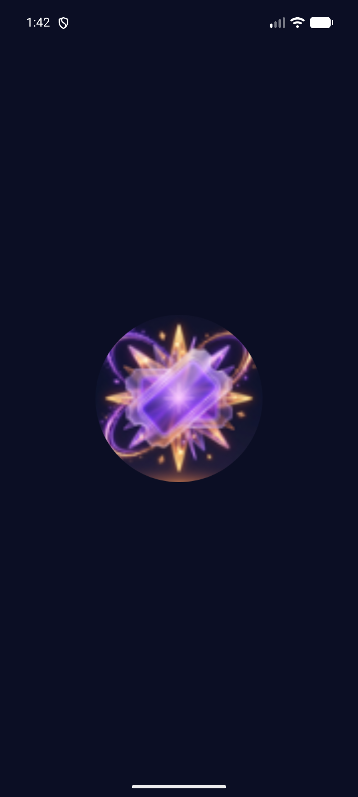 | Banner sự kiện nổi bật, danh mục dịch vụ tròn hiện đại, đồng hồ đếm ngược sự kiện sắp tới, danh sách dịch vụ đề xuất & đánh giá cao. |
| **02** | **Bộ lọc & Khám phá Dịch vụ** | 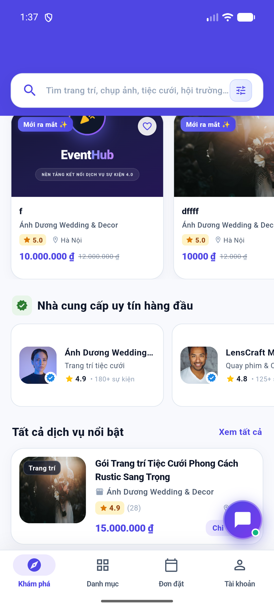 | Tìm kiếm theo từ khóa, lọc theo mức giá tối thiểu - tối đa, lọc theo địa điểm và danh mục chuyên biệt (Trang trí, Quay chụp, Âm thanh...). |
| **03** | **Chi tiết Dịch vụ Sự kiện** | 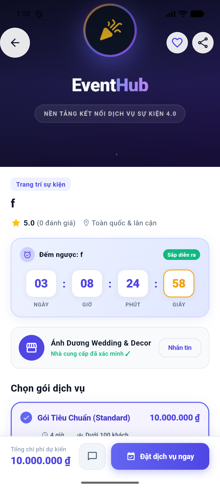 | Trình chiếu ảnh dịch vụ sắc nét, thông tin nhà cung cấp, bảng giá chi tiết, các tiện ích đi kèm và đánh giá từ khách hàng trước. |
| **04** | **Thanh toán Trực tuyến (SePay)** | 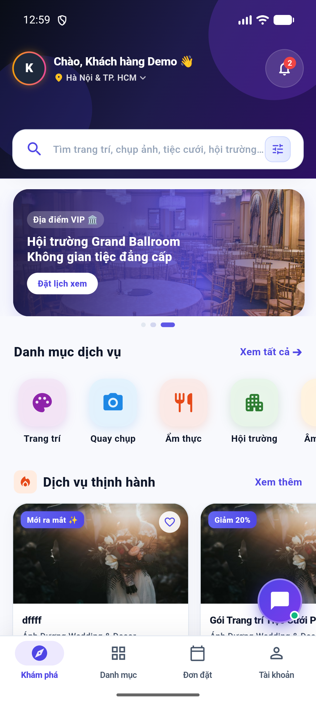 | Tích hợp cổng thanh toán SePay với mã VietQR tự động sinh, hiển thị đúng số tiền và nội dung chuyển khoản, webhook tự động xác nhận đơn. |
| **05** | **Đơn tiệc của tôi & Đồng bộ Lịch** | 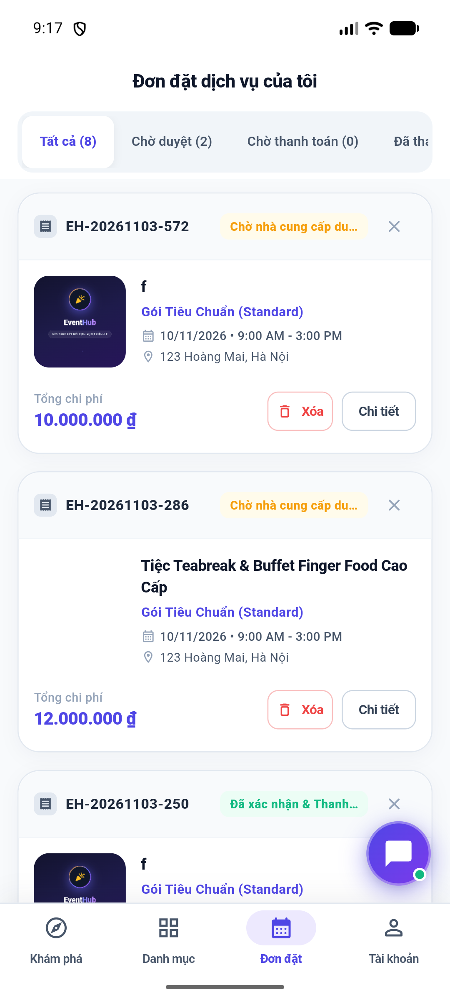 | Quản lý danh sách đơn theo tab (Chờ xác nhận, Đã cọc, Đang thực hiện, Đã xong); tích hợp nút bấm 1 chạm thêm sự kiện vào Lịch điện thoại. |
| **06** | **Trò chuyện Hỗ trợ Trực tuyến** | 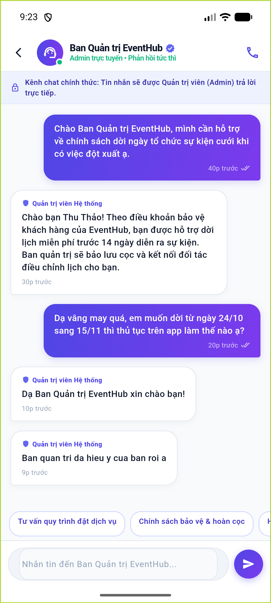 | Hệ thống tin nhắn thời gian thực giữa Khách hàng và Đội ngũ Hỗ trợ / Nhà cung cấp; bong bóng chat nổi tiện lợi trên toàn màn hình. |
| **07** | **Màn hình Cài đặt (Settings)** | 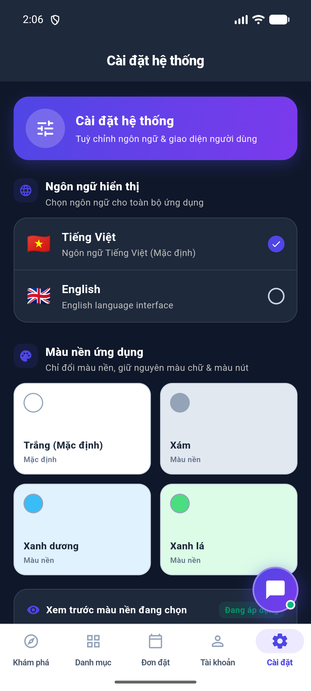 | Nút cài đặt tiện lợi đặt ngay cạnh nút Tài khoản; chứa tùy chọn đổi ngôn ngữ, đổi màu giao diện và đồng bộ lịch. |
| **08** | **Bộ chọn Màu nền Cá nhân hóa** | 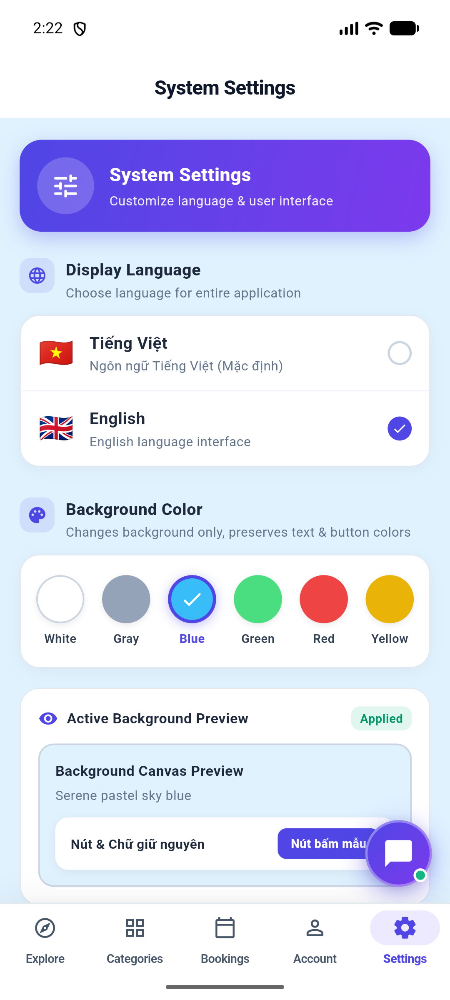 | Các ô tròn nhỏ chọn 6 màu nền: Trắng, Xám, Xanh dương, Xanh lá, Đỏ, Vàng (chỉ đổi nền, giữ nguyên màu chữ và màu nút chuẩn nhận diện). |
| **09** | **Chế độ Đa ngôn ngữ (English)** | 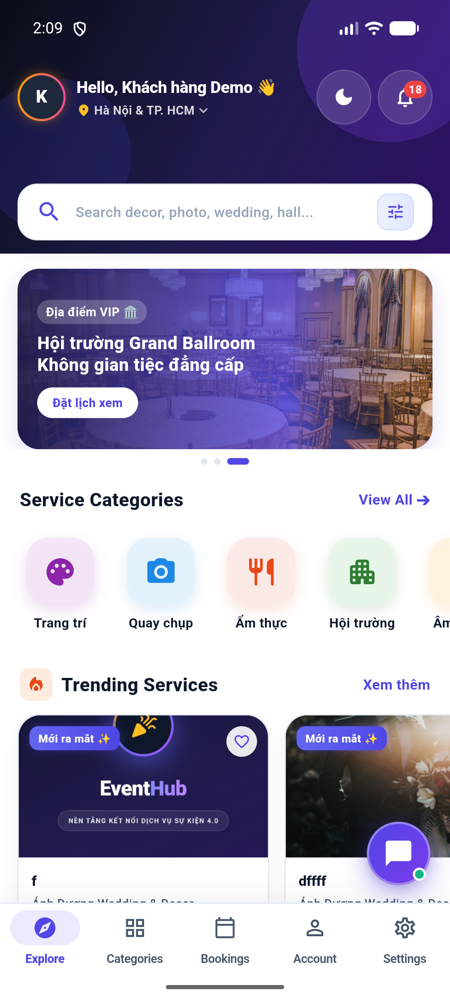 | Toàn bộ các thẻ, tiêu đề, nút bấm chuyển sang tiếng Anh hoàn hảo khi người dùng chọn English trong cài đặt. |

---

### 3.2. Phân hệ Nhà cung cấp (Provider Portal)

| # | Tên màn hình | Hình ảnh Mockup | Mô tả chức năng |
|---|---|:---:|---|
| **10** | **Bảng điều khiển Nhà cung cấp** | 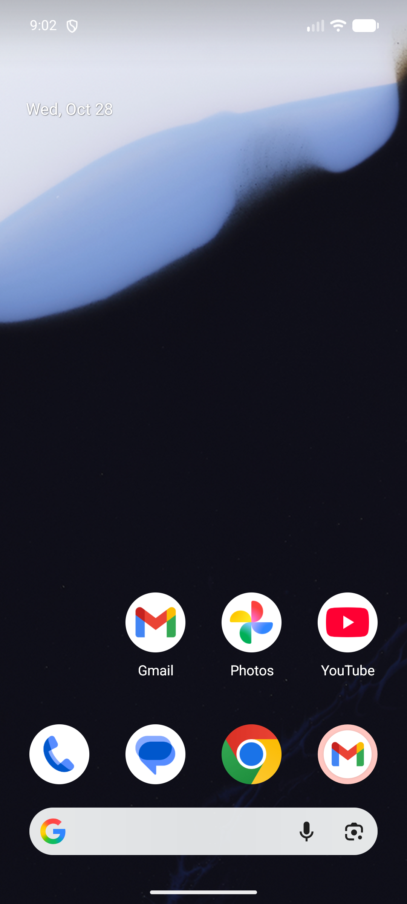 | Thống kê số lượng đơn hàng mới, tổng doanh thu thực nhận, trạng thái các booking cần xử lý ngay trong ngày. |
| **11** | **Quản lý Dịch vụ Sự kiện** | 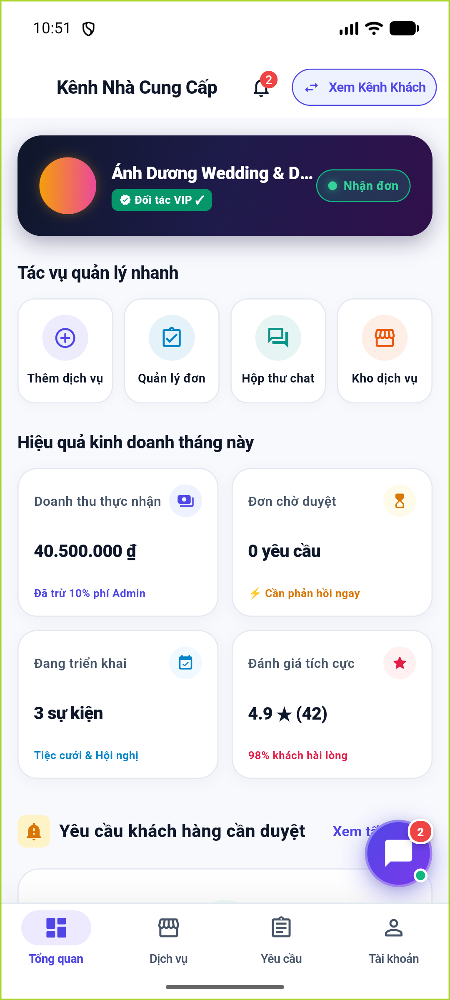 | Danh sách các gói dịch vụ nhà cung cấp đang cung cấp, xem trước trạng thái phê duyệt từ ban quản trị và tạo dịch vụ mới. |

---

### 3.3. Phân hệ Quản trị viên (Admin Portal)

| # | Tên màn hình | Hình ảnh Mockup | Mô tả chức năng |
|---|---|:---:|---|
| **12** | **Cổng thông tin Quản trị (Admin)** | 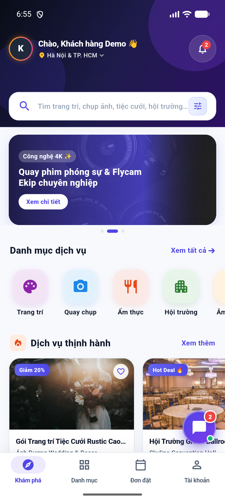 | Giao diện quản lý vận hành tổng thể: quản trị người dùng, theo dõi dòng tiền hoa hồng nền tảng và kiểm soát rủi ro. |
| **13** | **Kiểm duyệt Dịch vụ Mới** | 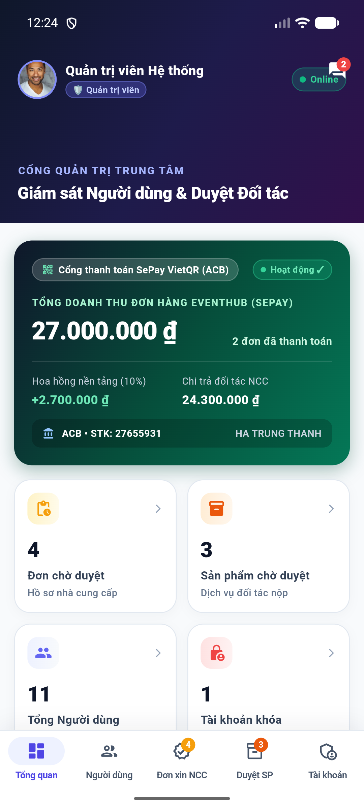 | Danh sách dịch vụ do nhà cung cấp gửi lên; Admin xem trước hình ảnh, mô tả, giá cả và bấm Phê duyệt / Từ chối kèm lý do. |
