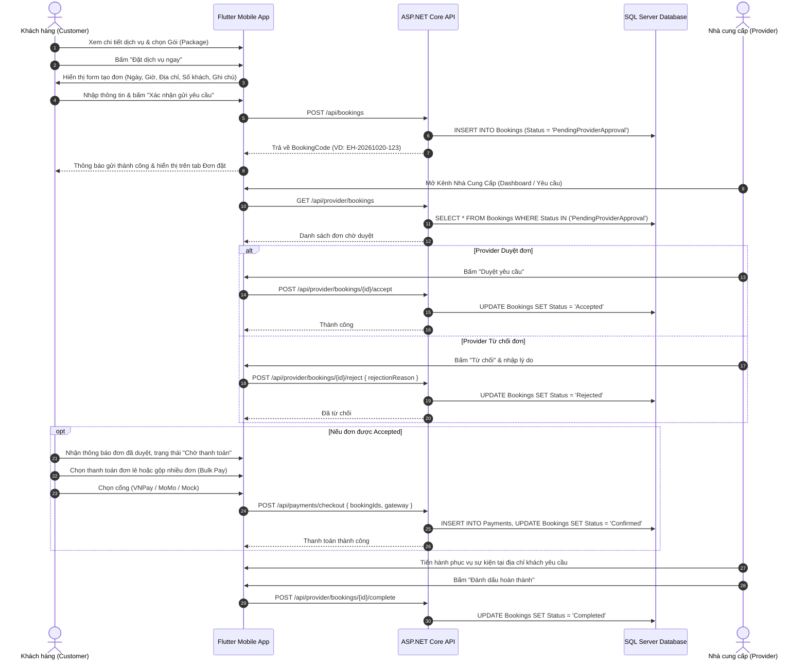

# EventHub — Tài Liệu Kiến Trúc & Luồng Đặt Đơn (Booking Flow Specification)

> **Mục đích tài liệu:** Lưu trữ chi tiết 100% luồng nghiệp vụ, mô hình dữ liệu, đặc tả API và mã nguồn của chức năng Đặt đơn dịch vụ (Service Booking) trên nền tảng EventHub để có thể tham chiếu hoặc phục hồi nguyên vẹn bất kỳ lúc nào.

---

## 1. Tổng quan luồng nghiệp vụ (Business Workflow)



---

## 2. Vòng đời trạng thái đơn đặt (State Machine)

| Mã trạng thái | Tên hiển thị tiếng Việt | Màu sắc | Ý nghĩa |
| :--- | :--- | :--- | :--- |
| `PendingProviderApproval` | Chờ nhà cung cấp duyệt | Vàng cam (`#ED6C02`) | Khách hàng vừa gửi form đặt đơn, nhà cung cấp đang xem xét lịch và yêu cầu. |
| `Accepted` | Đã duyệt (Chờ thanh toán) | Xanh dương (`#0288D1`) | Nhà cung cấp chấp thuận tiếp nhận sự kiện; khách hàng cần thanh toán cọc/toàn bộ. |
| `Confirmed` | Đã xác nhận & Thanh toán | Xanh lá (`#2E7D32`) | Đã thanh toán thành công qua cổng thanh toán (hoặc Mock Development). Sẵn sàng phục vụ. |
| `InProgress` | Đang triển khai sự kiện | Tím (`#673AB7`) | Đang trong thời gian diễn ra sự kiện theo ngày/giờ đã đặt. |
| `Completed` | Đã hoàn thành | Xanh lá đậm (`#1B5E20`) | Nhà cung cấp đã phục vụ xong, khách có thể viết đánh giá & nhận xét (Review). |
| `Rejected` | Đã từ chối | Đỏ (`#D32F2F`) | Nhà cung cấp từ chối do trùng lịch hoặc không đáp ứng yêu cầu. |
| `Cancelled` | Đã hủy | Xám / Đỏ nhạt (`#757575`) | Khách hàng chủ động hủy yêu cầu trước khi sự kiện bắt đầu. |

---

## 3. Cấu trúc Database (SQL Server DDL)

```sql
CREATE TABLE Bookings (
    Id UNIQUEIDENTIFIER PRIMARY KEY DEFAULT NEWID(),
    BookingCode NVARCHAR(50) NOT NULL UNIQUE,       -- Mã đơn chuẩn EH-YYYYMMDD-XXX
    CustomerId UNIQUEIDENTIFIER NOT NULL,           -- Khách hàng đặt
    ProviderId UNIQUEIDENTIFIER NOT NULL,           -- Nhà cung cấp nhận đơn
    ServiceId UNIQUEIDENTIFIER NOT NULL,            -- Dịch vụ sự kiện
    PackageId UNIQUEIDENTIFIER NULL,                -- Gói dịch vụ được chọn
    EventDate DATETIME2 NOT NULL,                   -- Ngày tổ chức sự kiện
    StartTimeUtc DATETIME2 NULL,                    -- Giờ bắt đầu
    EndTimeUtc DATETIME2 NULL,                      -- Giờ kết thúc
    EventAddress NVARCHAR(500) NOT NULL,            -- Địa chỉ tổ chức
    City NVARCHAR(100) NOT NULL,                    -- Tỉnh / Thành phố
    GuestCount INT NOT NULL DEFAULT 100,            -- Quy mô lượng khách
    SpecialRequirements NVARCHAR(MAX) NULL,         -- Ghi chú / Yêu cầu đặc biệt
    PackageNameSnapshot NVARCHAR(255) NOT NULL,     -- Lưu snapshot tên gói lúc đặt
    PackagePriceSnapshot DECIMAL(18, 2) NOT NULL,   -- Giá gói lúc đặt
    TotalAmount DECIMAL(18, 2) NOT NULL,            -- Tổng giá trị đơn
    Status NVARCHAR(50) NOT NULL DEFAULT 'PendingProviderApproval',
    RejectionReason NVARCHAR(MAX) NULL,             -- Lý do từ chối (nếu có)
    CancellationReason NVARCHAR(MAX) NULL,          -- Lý do hủy (nếu có)
    CancelledByUserId UNIQUEIDENTIFIER NULL,
    StatusUpdatedAt DATETIME2 NOT NULL DEFAULT GETUTCDATE(),
    CreatedAt DATETIME2 NOT NULL DEFAULT GETUTCDATE()
);

-- Hỗ trợ gộp đơn thanh toán (Bulk Checkout)
CREATE TABLE Payments (
    Id UNIQUEIDENTIFIER PRIMARY KEY DEFAULT NEWID(),
    PaymentCode NVARCHAR(50) NOT NULL UNIQUE,
    CustomerId UNIQUEIDENTIFIER NOT NULL,
    TotalAmount DECIMAL(18, 2) NOT NULL,
    Currency NVARCHAR(10) NOT NULL DEFAULT 'VND',
    PaymentGateway NVARCHAR(50) NOT NULL,           -- VNPay | MoMo | MockDevelopment
    Status NVARCHAR(50) NOT NULL DEFAULT 'Pending', -- Pending | Succeeded | Failed | Cancelled
    GatewayTransactionNo NVARCHAR(100) NULL,
    PaidAt DATETIME2 NULL,
    CreatedAt DATETIME2 NOT NULL DEFAULT GETUTCDATE()
);

CREATE TABLE PaymentItems (
    Id UNIQUEIDENTIFIER PRIMARY KEY DEFAULT NEWID(),
    PaymentId UNIQUEIDENTIFIER NOT NULL,
    BookingId UNIQUEIDENTIFIER NOT NULL,
    Amount DECIMAL(18, 2) NOT NULL,
    CreatedAt DATETIME2 NOT NULL DEFAULT GETUTCDATE()
);
```

---

## 4. Đặc tả REST API Endpoints

### 4.1. Khách hàng tạo đơn
- **Endpoint:** `POST /api/bookings`
- **Request Body:**
```json
{
  "serviceId": "3fa85f64-5717-4562-b3fc-2c963f66afa6",
  "packageId": "pkg-1",
  "packageNameSnapshot": "Gói Tiêu Chuẩn (Rustic Decor)",
  "packagePriceSnapshot": 15000000,
  "totalAmount": 15000000,
  "eventDate": "2026-10-24T00:00:00Z",
  "eventAddress": "123 Hoàng Mai, Hà Nội",
  "city": "Hà Nội",
  "guestCount": 120,
  "specialRequirements": "Bổ sung 2 trụ hoa tươi ở lối đi",
  "customerName": "Nguyễn Văn Nam",
  "customerPhone": "0912 345 678"
}
```

### 4.2. Khách hàng xem lịch sử đơn
- **Endpoint:** `GET /api/bookings/my`
- **Response:** Danh sách các `Booking` sắp xếp theo `CreatedAt DESC`.

### 4.3. Nhà cung cấp nhận danh sách đơn
- **Endpoint:** `GET /api/provider/bookings`
- **Response:** Danh sách các `Booking` thuộc thẩm quyền của Provider.

### 4.4. Nhà cung cấp thao tác duyệt / từ chối / hoàn thành
- `POST /api/provider/bookings/{id}/accept`: Chuyển `Status` sang `Accepted`.
- `POST /api/provider/bookings/{id}/reject`: Body `{ "rejectionReason": "Đã kín lịch" }`, chuyển `Status` sang `Rejected`.
- `POST /api/provider/bookings/{id}/complete`: Chuyển `Status` sang `Completed`.

### 4.5. Thanh toán đơn lẻ hoặc gộp nhiều đơn
- **Endpoint:** `POST /api/payments/checkout`
- **Request Body:**
```json
{
  "bookingIds": ["b1", "b2"],
  "paymentGateway": "VNPay"
}
```
- **Response:** Chuyển trạng thái các đơn trong mảng sang `Confirmed`.

---

## 5. Kiến trúc Code phía Client Flutter

### 5.1. Model: `BookingModel`
- Các trường: `id`, `code`, `serviceId`, `serviceTitle`, `providerName`, `packageName`, `packageId`, `date`, `time`, `price`, `rawPrice`, `status`, `imageUrl`, `location`, `guestCount`, `notes`, `customerName`, `customerPhone`, `paymentGateway`, `createdAt`.
- Getters: `statusLabel`, `statusColor`, `statusBg`.
- Serialization: `toJson()` & `BookingModel.fromJson(...)`.

### 5.2. State Management: `bookingProvider` (`BookingNotifier`)
- Quản lý danh sách `List<BookingModel>`.
- **Cơ chế Offline-First / Persistent Cache:** Tự động đồng bộ với `SharedPreferences` (key `'eventhub_local_bookings_v1'`).
- Tự động gọi API nền: `_apiClient.dio.post('/bookings')`, `_apiClient.dio.get('/bookings/my')`.
- Methods:
  - `addBooking(...)`: Thêm đơn mới vào đầu danh sách, lưu ổ đĩa, bắn API.
  - `paySingleBooking(...)`: Thanh toán 1 đơn.
  - `bulkPayAccepted(...)`: Gộp thanh toán tất cả đơn đã duyệt.
  - `cancelBooking(...)`: Hủy đơn.
  - `acceptProviderBooking(...)`: Provider duyệt đơn.
  - `rejectProviderBooking(...)`: Provider từ chối.
  - `completeProviderBooking(...)`: Đánh dấu hoàn thành.

### 5.3. Màn hình giao diện (Screens)
- **`CreateBookingScreen`:** Form nhập ngày (`showDatePicker`), giờ bắt đầu/kết thúc (`showTimePicker`), địa chỉ tổ chức, số lượng khách, yêu cầu đặc biệt.
- **`MyBookingsScreen`:** Gồm 6 Tab phân loại (Tất cả, Chờ duyệt, Chờ thanh toán, Đã thanh toán, Hoàn thành, Đã hủy) + Thanh gộp thanh toán nhiều đơn (Bulk Payment Bottom Bar).
- **`BookingDetailScreen`:** Xem chi tiết mã đơn, tiến trình thời gian sự kiện, địa chỉ, số tiền và nút Thanh toán ngay / Hủy đơn.
- **`ProviderBookingsScreen` & `ProviderDashboardScreen`:** Kênh nhà cung cấp để xem các yêu cầu khẩn cấp và duyệt/từ chối ngay trên máy.

---

## 6. Hướng dẫn phục hồi (How to Restore)

Nếu muốn kích hoạt lại toàn bộ tính năng Đặt đơn trong tương lai:
1. Tạo lại entity [Booking.cs](file:///d:/Ki8/PRM393/EventHub/backend/EventHub.Domain/Entities/Booking.cs) và đăng ký `DbSet<Booking>` trong [EventHubDbContext.cs](file:///d:/Ki8/PRM393/EventHub/backend/EventHub.Infrastructure/Data/EventHubDbContext.cs).
2. Tạo lại [BookingsController.cs](file:///d:/Ki8/PRM393/EventHub/backend/EventHub.API/Controllers/BookingsController.cs).
3. Đưa thư mục `mobile/lib/features/bookings/` trở lại với `BookingModel`, `BookingNotifier`, `MyBookingsScreen`, `CreateBookingScreen`, `BookingDetailScreen`.
4. Mở lại route `/bookings` và `/services/:id/book` trong [app_router.dart](file:///d:/Ki8/PRM393/EventHub/mobile/lib/core/routing/app_router.dart).
5. Chuyển nút bấm tại [service_detail_screen.dart](file:///d:/Ki8/PRM393/EventHub/mobile/lib/features/services/screens/service_detail_screen.dart) trỏ tới `/services/:id/book`.
