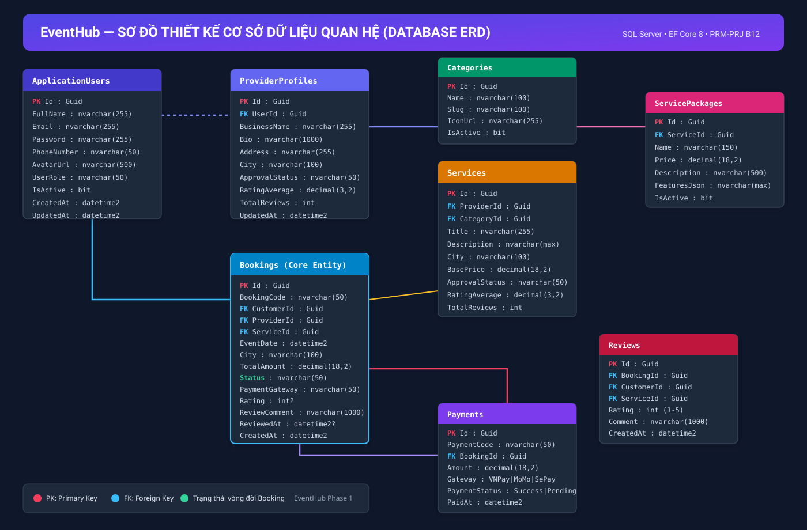
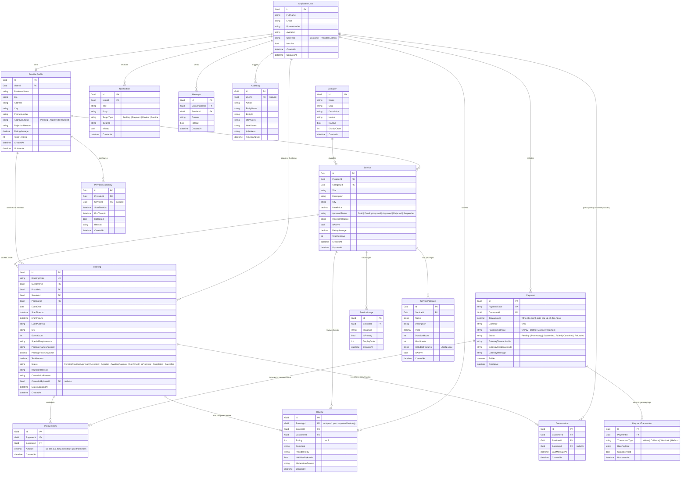

# EventHub — Database Schema & Entity Relationship Design (ERD)

## 1. Overview

The EventHub database runs on **Microsoft SQL Server** and is managed via **Entity Framework Core 8 Code-First migrations**. All primary keys are `Guid` (UUID) or normalized unique codes. Currency columns use `decimal(18,2)`. All timestamps use UTC (`DateTime`).

---

## 2. Visual & Mermaid Entity-Relationship Diagram (ERD)

### 2.1 Sơ đồ Trực Quan Độ Nét Cao (High-Resolution Diagram)
> **Xem file ảnh gốc trên GitHub**: [`docs/database/ERD_visual.svg`](https://github.com/thanhcon14022004/EventHub/blob/main/docs/database/ERD_visual.svg)

### 2.2 Sơ đồ Mermaid ERD Code

---

## 3. Key Relationships and Rules

1. **Price Snapshots**: When a customer confirms a booking, the package's name and price at that exact moment are recorded in `PackageNameSnapshot` and `PackagePriceSnapshot`. If the provider subsequently changes package pricing, historical bookings remain unchanged.
2. **Double Booking Prevention**:
   - `ProviderAvailability` tracks explicit blackouts.
   - Any booking in `Accepted`, `AwaitingPayment`, `Confirmed`, or `InProgress` locks that provider's schedule for overlapping time windows `[StartTimeUtc, EndTimeUtc]`.
3. **Review Eligibility**:
   - Customer can only review a booking with `Status == Completed`.
   - `BookingId` is unique in `Review` table (1 booking = max 1 review).
4. **Payment Idempotency**:
   - Gateway callbacks check whether `Payment.Status == Succeeded`. If already succeeded, repeated callbacks log to `PaymentTransaction` and return success without double-crediting or duplicate booking status updates.
5. **Aggregate Payment (Thanh toán tổng tất cả đơn hàng)**:
   - Hệ thống hỗ trợ khách hàng thanh toán lẻ từng đơn hoặc **thanh toán gộp tổng tất cả các đơn hàng** (các đơn ở trạng thái `Accepted` / `AwaitingPayment`) trong 1 lần giao dịch duy nhất.
   - Bảng `Payment` lưu `TotalAmount` là tổng tiền của tất cả các đơn hàng được gộp thanh toán (`TotalAmount = ∑ Booking.TotalAmount`).
   - Bảng `PaymentItem` lưu chi tiết danh sách từng `BookingId` và số tiền tương ứng được thanh toán trong phiên giao dịch đó.
   - Khi thanh toán qua cổng (VNPay/MoMo) thành công (`Payment.Status == Succeeded`), hệ thống tự động cập nhật tất cả các `Booking` có trong `PaymentItem` sang trạng thái `Confirmed` và khóa lịch phục vụ.
