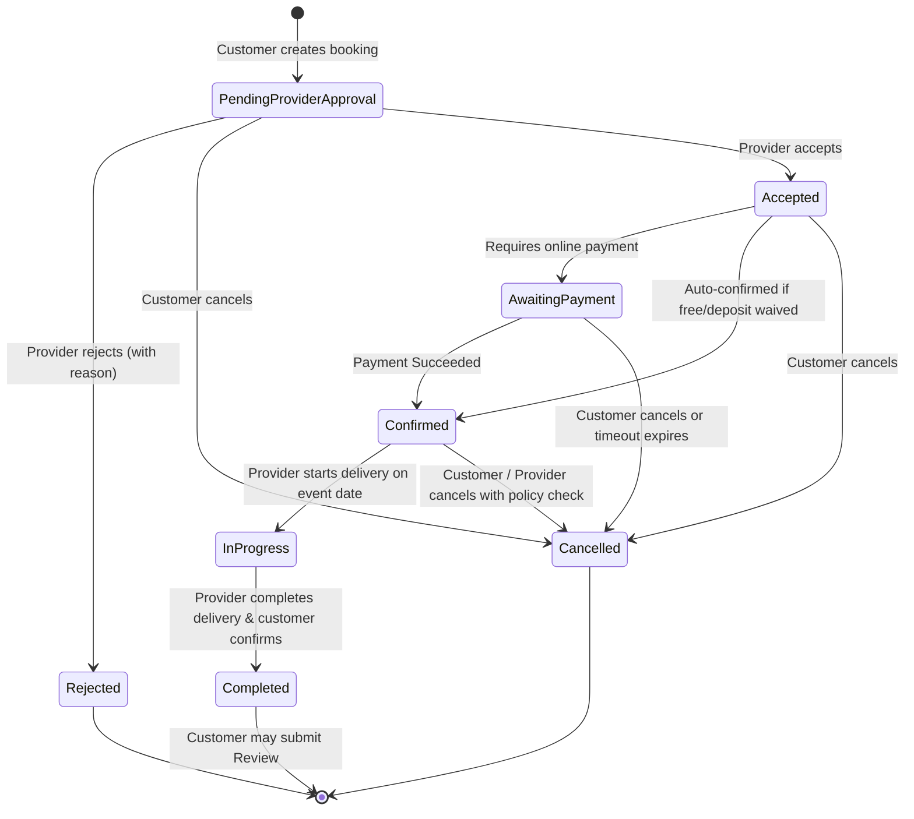
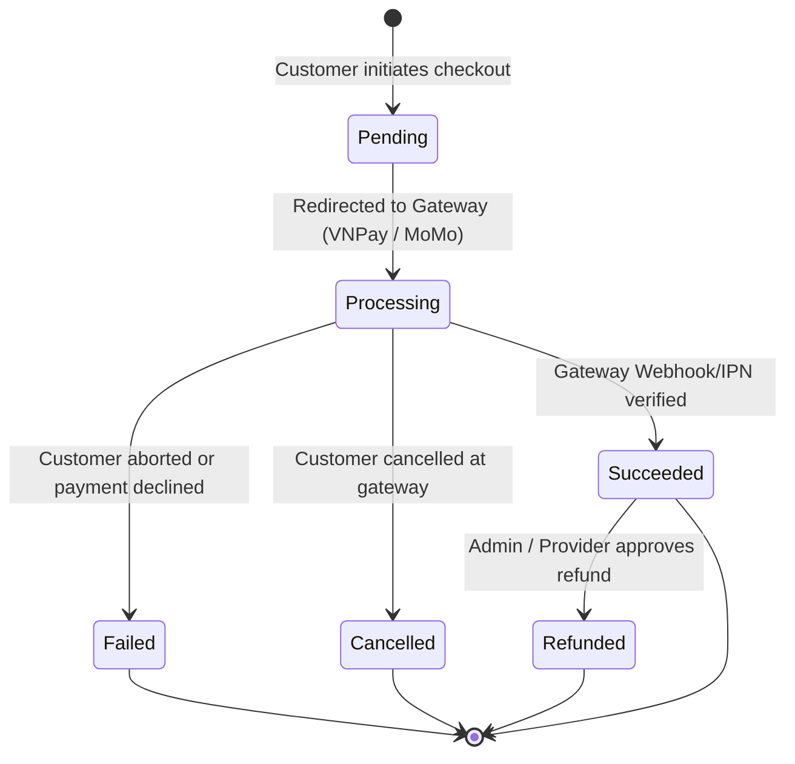

# EventHub — Booking & Payment State Transitions & Rules

## 1. Booking Status Lifecycle & State Machine

Every booking transitions through strictly verified statuses. Invalid transitions are rejected by the backend with HTTP `400 Bad Request` or `409 Conflict`.

### Transition Matrix & Authorized Actors

| Current Status | Target Status | Authorized Actor | Pre-Conditions & Rules |
| :--- | :--- | :--- | :--- |
| `None` | `PendingProviderApproval` | Customer | Service is Approved & Active; Schedule has no conflicts; Package exists. |
| `PendingProviderApproval` | `Accepted` | Provider (Owner) | Schedule still open; Provider approves date & guest count. |
| `PendingProviderApproval` | `Rejected` | Provider (Owner) | Provider must provide `RejectionReason`. |
| `PendingProviderApproval` | `Cancelled` | Customer | Allowed at any time prior to approval. |
| `Accepted` | `AwaitingPayment` | System | Transitioned when online checkout is initiated. |
| `AwaitingPayment` | `Confirmed` | System (Webhook) | Gateway callback verified (HMAC/signature match, amount match, status Succeeded). |
| `Confirmed` | `InProgress` | Provider (Owner) | Current date matches or is within event window. |
| `InProgress` | `Completed` | Provider (Owner) / Admin | Service delivery concluded. Unlocks review eligibility. |
| `Confirmed` | `Cancelled` | Customer / Provider | Follows cancellation policy (e.g. >48h before event = full refund). |

---

## 2. Payment Lifecycle & State Machine

### Payment Verification Rules:
1. **Authoritative Calculation**: Amount is NEVER taken from Flutter client request body. Backend validates and calculates `Payment.TotalAmount = ∑ Booking.TotalAmount` for all selected `bookingIds` that belong to the authenticated customer and are in `Accepted` or `AwaitingPayment` status.
2. **Signature Verification**: VNPay `vnp_SecureHash` or MoMo HMAC SHA256 is verified before updating records.
3. **Idempotency**: Repeated webhooks for the same `PaymentCode` check `if (payment.Status == PaymentStatus.Succeeded) return Ok();` without mutating data or issuing duplicate events.
4. **Separation & Multi-Booking Sync**: Payment status (`Succeeded`) is tracked independently. Upon successful payment verification, the system batch-updates all associated `Booking` items in `PaymentItem` from `Accepted` / `AwaitingPayment` to `BookingStatus.Confirmed`.

---

## 3. Review Eligibility Rule

A user can only submit a review if:
1. `Booking.CustomerId == currentUserId`
2. `Booking.Status == BookingStatus.Completed`
3. No review exists yet for this `BookingId` (enforced by Unique Index on `Review.BookingId`).
4. Rating is an integer from `1` to `5`.
