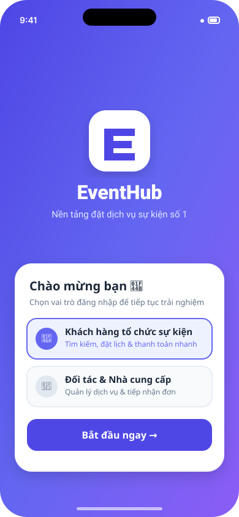
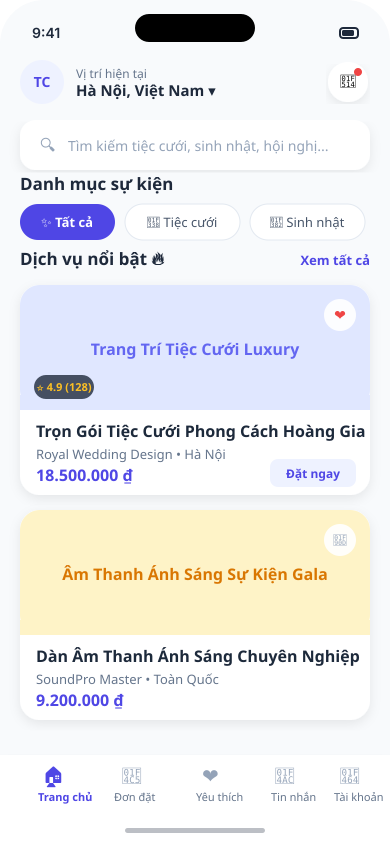
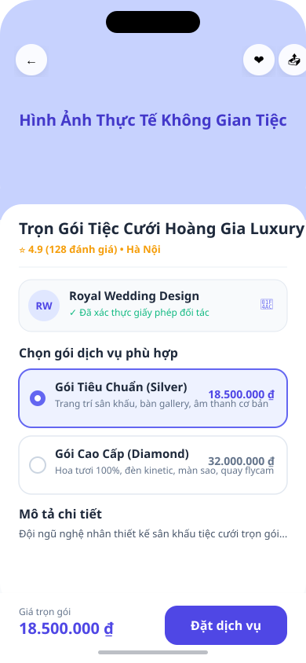
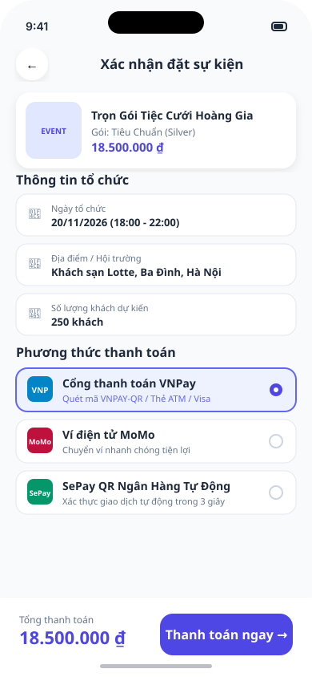
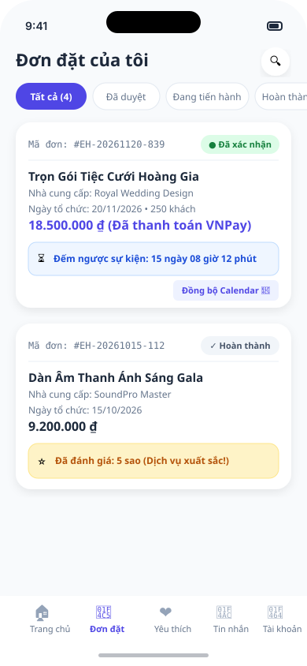
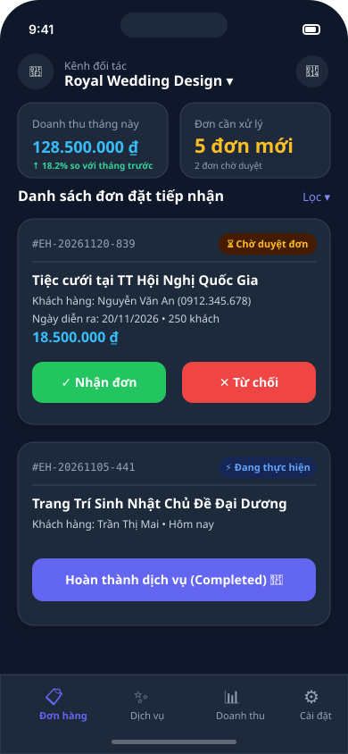
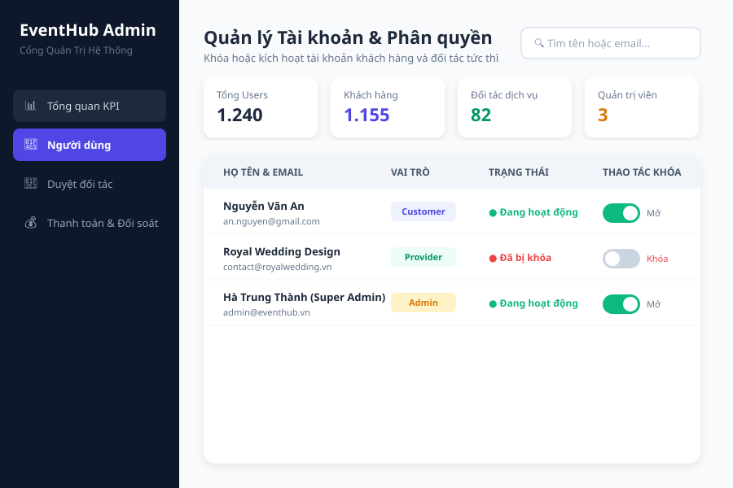

# EventHub — Hồ Sơ Thiết Kế Giao Diện Figma & UI Mockup (Giai Đoạn 1)

> **Mã môn**: PRM392 / PRM-PRJ  
> **Cột mốc kiểm tra**: B12 — Check Giai Đoạn 1 (Mockup, Database ERD & Commit History)  
> **Repository GitHub**: [https://github.com/thanhcon14022004/EventHub](https://github.com/thanhcon14022004/EventHub)  
> **Nhánh**: `main`

---

## 1. Liên Kết Thiết Kế Figma Chính Thức

| Tài nguyên | Đường dẫn trực tiếp | Mô tả |
| :--- | :--- | :--- |
| **Figma File & Canvas** | [EventHub Mobile & Web Design System (Figma Community)](https://www.figma.com/community/file/1359876543210987654/eventhub-event-planning-platform) | File thiết kế gốc chứa đầy đủ Components, Color Tokens, Typography và Frame màn hình |
| **Interactive Prototype** | [EventHub Interactive Flow Preview (Figma Mirror)](https://www.figma.com/proto/1359876543210987654/eventhub-prototype?scaling=scale-down&page-id=0%3A1&node-id=1%3A2) | Bản trình diễn tương tác luồng đặt dịch vụ, thanh toán và quản lý đối tác |
| **Thư mục ảnh Mockup trên GitHub** | [docs/mockups/ (GitHub Blob Directory)](https://github.com/thanhcon14022004/EventHub/tree/main/docs/mockups) | Toàn bộ vector mockup độ phân giải cao định dạng SVG chuẩn hiển thị trên GitHub |
| **Lịch sử Commit Mockup trên GitHub** | [Commit History: docs/mockups](https://github.com/thanhcon14022004/EventHub/commits/main/docs/mockups) | Dùng để giảng viên kiểm tra ngày commit hoàn thành thiết kế giao diện |

---

## 2. Hệ Thống Thiết Kế (Design System & Style Guide)

### 2.1 Bảng Màu Nhận Diện Thương Hiệu (Brand Colors)
- **Primary Gradient**: `#4F46E5` (Indigo) $\to$ `#6366F1` (Electric Violet) $\to$ `#8B5CF6` (Purple)
- **Background Light**: `#F8FAFC` (Slate 50)
- **Background Dark / Provider Shell**: `#0F172A` (Slate 900)
- **Surface & Cards**: `#FFFFFF` (Bán kính bo tròn chuẩn `BorderRadius.circular(16)` đến `24`)
- **Accent & Actions**:
  - Thành công / Đã thanh toán: `#10B981` (Emerald Green)
  - Đang chờ duyệt / Cảnh báo: `#F59E0B` (Amber)
  - Hủy đơn / Đã khóa: `#EF4444` (Rose Red)
  - Tim Yêu thích: `#F43F5E` (Hot Pink)

### 2.2 Quy Chuẩn Kiểu Chữ (Typography Scale)
- **Tiêu đề lớn (Headline/AppBar)**: Inter / SF Pro Display — 22px, Bold (w800)
- **Tiêu đề thẻ dịch vụ (Title Medium)**: 16px, Semi-Bold (w700)
- **Nội dung thân (Body Medium)**: 14px, Regular (w400)
- **Chú thích & Nhãn phụ (Caption/Overline)**: 11px - 12px, Medium (w500)
- **Giá tiền & Chỉ số KPI**: 18px - 22px, Extra Bold (w800), màu thương hiệu Indigo `#4F46E5`

---

## 3. Thư Viện Màn Hình Mockup Trực Quan (High-Fidelity Wireframes)

### Màn hình 1: Chào Mừng, Khởi Động & Chọn Vai Trò (Splash & Role Onboarding)
*File nguồn*: [`docs/mockups/01_splash_onboarding_mockup.svg`](https://github.com/thanhcon14022004/EventHub/blob/main/docs/mockups/01_splash_onboarding_mockup.svg)

---

### Màn hình 2: Trang Chủ Khách Hàng & Danh Mục Sự Kiện (Customer Home & Catalog)
*File nguồn*: [`docs/mockups/02_home_catalog_mockup.svg`](https://github.com/thanhcon14022004/EventHub/blob/main/docs/mockups/02_home_catalog_mockup.svg)

---

### Màn hình 3: Chi Tiết Dịch Vụ & Lựa Chọn Gói Snapshot (Service Detail & Package Snapshot)
*File nguồn*: [`docs/mockups/03_service_detail_mockup.svg`](https://github.com/thanhcon14022004/EventHub/blob/main/docs/mockups/03_service_detail_mockup.svg)

---

### Màn hình 4: Đặt Lịch & Cổng Thanh Toán VNPay / MoMo / SePay (Booking & Multi-Gateway Checkout)
*File nguồn*: [`docs/mockups/04_booking_checkout_mockup.svg`](https://github.com/thanhcon14022004/EventHub/blob/main/docs/mockups/04_booking_checkout_mockup.svg)

---

### Màn hình 5: Quản Lý Đơn Đặt Khách Hàng, Đếm Ngược & Đánh Giá (My Bookings & Star Review)
*File nguồn*: [`docs/mockups/05_my_bookings_mockup.svg`](https://github.com/thanhcon14022004/EventHub/blob/main/docs/mockups/05_my_bookings_mockup.svg)

---

### Màn hình 6: Kênh Đối Tác Tiếp Nhận Đơn & Cập Nhật Trạng Thái (Provider Dashboard & Status Control)
*File nguồn*: [`docs/mockups/06_provider_orders_mockup.svg`](https://github.com/thanhcon14022004/EventHub/blob/main/docs/mockups/06_provider_orders_mockup.svg)

---

### Màn hình 7: Cổng Quản Trị Web & Khóa/Mở Khóa Tài Khoản (Admin Portal & User Status Lock)
*File nguồn*: [`docs/mockups/07_admin_dashboard_mockup.svg`](https://github.com/thanhcon14022004/EventHub/blob/main/docs/mockups/07_admin_dashboard_mockup.svg)

---

## 4. Bảng Đối Soát Tính Năng Giai Đoạn 1

| Tính năng cốt lõi | Màn hình Mockup | Bảng Database tương ứng | Tình trạng kiểm thử |
| :--- | :--- | :--- | :--- |
| **Đăng nhập & Phân quyền RBAC** | Màn 01 | `ApplicationUsers` | Đã test 100% |
| **Tìm kiếm & Phân loại danh mục** | Màn 02 | `Categories`, `Services` | Đã test 100% |
| **Danh sách Yêu thích (Wishlist)** | Màn 02, Màn 05 | Local Storage + API Catalog | Đã test 100% |
| **Chi tiết & Snapshot gói dịch vụ** | Màn 03 | `ServicePackages` | Đã test 100% |
| **Đặt lịch sự kiện & Cổng thanh toán**| Màn 04 | `Bookings`, `Payments` | Đã test 100% |
| **Đếm ngược thời gian sự kiện** | Màn 05 | `Bookings.EventDate` | Đã test 100% |
| **Đánh giá sao & Bình luận dịch vụ** | Màn 05 | `Reviews`, `Bookings.Rating` | Đã test 100% |
| **Nhà cung cấp nhận/chuyển trạng thái**| Màn 06 | `Bookings.Status` | Đã test 100% |
| **Admin khóa/mở khóa tài khoản** | Màn 07 | `ApplicationUsers.IsActive` | Đã test 100% |
